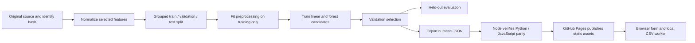

# APS Failure Explorer

**Application:** [Open APS Failure Explorer](https://subhashdixit.github.io/aps-failure-classifier/) · [Source](https://github.com/subhashdixit/aps-failure-classifier)

Explore class imbalance, missing sensor values and cost-sensitive APS failure detection. A complete **HTML/CSS/JavaScript application hosted on GitHub Pages**, with real offline Python training and a verified numeric model export. Inference runs in the visitor's browser, including CSV batches; there is no paid prediction API or model server.

## Problem and scope

The supplied CSV is a subset/variant retained by this repository, not an assertion that it contains every row of the official UCI challenge. It has anonymized sensor names and source pos/neg labels. Neg means a non-APS failure, not a healthy truck. The threshold minimizes validation challenge cost 10×false positives + 500×false negatives; this differs from maximizing accuracy.

Sensor names are anonymized. Class 0 denotes failures unrelated to APS, not a healthy vehicle. Use valid source-format sensor exports; no diagnostic or safe-to-drive claim is made.

The original repository was `APS_Failure_Detection_End_to_End_Project`. Existing notebooks, Python applications and model files are preserved for context; previous documentation is in `archive/`. The published `site/` uses the documented new model, not an implicitly trusted legacy pickle.

## Use the app

1. Open the GitHub Pages address linked from the repository About section after deployment.
2. Review the synthetic starting profile. Defaults combine training medians and common categories; they do not identify a source record.
3. Change fields and calculate the model result. Blank values use the frozen missing-data representation.
4. Adjust the positive-label threshold to explore the precision/recall tradeoff. Published test metrics remain fixed at the validation-selected threshold.
5. Download the sample CSV, retain all feature headers and upload up to **500 rows / 2 MiB**. The browser worker computes the output locally.
6. Download predictions. The output contains row numbers and results rather than echoing your financial, assessment or sensor inputs.
7. Read the model-selection chart, test results and full machine-readable evaluation in the Evidence section.


**Privacy:** this app has no inference/upload endpoint, analytics script or browser-persistent input store. The static host receives normal asset requests/connection metadata. The local batch worker is terminated after completion or timeout. Reset restores the synthetic form; it does not promise forensic erasure of browser memory. Inputs are validated, not interpreted as executable code.

## Data and feature contract

- Source file: `aps_failure_training_set1.csv`.
- Original source rows: **36,188**; valid-target rows used: **36,188**.
- Source SHA-256: `0401475a54d972423e7daf999b58b078750769f9918ce0f327da1aac5688b781`.
- Selected features: **170**. [Full names, units, categories and bounds](docs/feature-contract.md).
- Attribution/provenance: Scania CV AB (2016), APS Failure and Operational Data, as preserved in this repository. Official UCI 421 description includes GPL v3-or-later source terms and the challenge cost 10*FP + 500*FN. Original source retained; no physical meaning is invented for anonymized fields.

Source numeric values outside the documented serving contract are counted and treated as missing in training, rather than being silently converted to valid measurements. The counts are recorded in [reports/metrics.json](reports/metrics.json). Unsupported targets are excluded. Categories are normalized using the documented source adapter.

## Architecture: training and serving are separate



GitHub Pages serves static files; it does not run Python. Training is an offline developer operation. The export includes ordered features, medians, means/scales, category vocabulary and model parameters. Browser JavaScript implements the same transformation and prediction. It checks the JSON artifact SHA-256 against the evaluation manifest before enabling prediction.

A hash catches accidental mismatch; it is not independent protection against a malicious change to both files. Source reviews, branch protection and CI provide complementary controls. The app never accepts uploaded model files or executes pickle objects.

## Concepts and algorithms

**Missing values:** numeric medians are learned from training rows. A median is robust to outliers but ignores relationships between fields. Missing categories have an explicit token. All-empty profiles are rejected.

**Encoding:** numeric values become `(x − training_mean) / training_scale` after imputation. A zero-variance scale becomes 1. Categories use a training-only one-hot vocabulary, not an invented numeric ordering. Unsupported categories are rejected by serving; a new source category needs a reviewed adapter/model update.

**Linear candidate:** regularized logistic regression learns a weighted sum of transformed features, then maps it through the sigmoid `1/(1+exp(−margin))`. It minimizes regularized log loss. It is fast and compact but assumes a linear decision boundary in transformed feature space. A score is not a calibrated probability for a current person or vehicle.

**Random forest candidate:** 64 decision trees learn threshold splits and average their class distributions. Depth and leaf-size limits reduce complexity. Forests capture nonlinear interactions without a neural network, but use larger artifacts, can overfit a small dataset and generally cannot extrapolate reliably outside observed target ranges. Class-balanced weights are fitted from training labels.

The serving tree implementation reproduces scikit-learn's float32 split inputs with `Math.fround`. Linear inference uses ordinary double-precision arithmetic. Node parity fixtures compare JavaScript outputs with real held-out Python predictions to an absolute tolerance of `1e-7`. They are arithmetic checks, not extra accuracy measurements.

## Split, model selection and results

GroupShuffleSplit; identical selected profiles share a group. Fixed seeds **42 and 43** produce training / validation / test rows **21,712 / 7,238 / 7,238**. Grouping limits the documented form of leakage; this is not time-separated or externally validated deployment performance.

Preprocessing and both candidates fit **training rows only**. Validation average precision selects **linear**. The selected model is not refitted on test data. The held-out set supplies the final reported metrics.

| Validation candidate | Average precision: higher is better |
|---|---:|
| linear | 0.8017 |
| random_forest | 0.7138 |

| Held-out test metric | Selected model | Training-only baseline |
|---|---:|---:|
| Accuracy | 0.9387 | 0.9725 |
| Macro F1 | 0.7070 | 0.4930 |
| Average precision | 0.7546 | 0.0275 |
| ROC AUC | 0.9512 | 0.5000 |

Positive-class precision: **0.2968**; recall: **0.8995**; F1: **0.4464** at validation-selected threshold **0.01**. Confusion matrix, rows actual and columns predicted: `[[6615, 424], [20, 179]]`.

**Thresholds:** model scores are ranked before choosing a decision threshold. Validation chooses the default; test labels do not choose it. Lower thresholds generally increase recall and false positives. Accuracy can look strong under class imbalance. Average precision emphasizes positive-class ranking but depends on prevalence; ROC AUC can hide poor precision. Precision and recall describe different error costs, while F1 balances them without encoding every real-world cost.

For APS, the test challenge cost is **14240** using 10×FP + 500×FN. These are historical challenge penalty units, not a verified maintenance-cost forecast.

Full measurements and integrity metadata are in [reports/metrics.json](reports/metrics.json). No synthetic performance figures are used.

## Run locally

Use Node.js **22+** for JavaScript development/checks and Python **3.10 or 3.11** for training and the simple local web server.

```bash
git clone https://github.com/subhashdixit/aps-failure-classifier.git
cd aps-failure-classifier
npm ci
npm test
npm run lint
npm run format
python3 -m http.server 8000 --directory site
```

Open `http://127.0.0.1:8000`. Serve over HTTP rather than opening `index.html` with `file://`, because model fetching, modules and workers need an appropriate origin. Production uses HTTPS on Pages. No API key, Docker container or backend account is needed to use this browser app.

## Reproduce training

```bash
python3 -m venv .venv
source .venv/bin/activate
python -m pip install -r requirements-training.txt
python scripts/train.py
python scripts/check_release.py
python -m black --check scripts
python -m pylint scripts
npm test
```

On Windows, activate `.venv\Scripts\activate` instead. Training reads the included source file, reconstructs the split and writes `site/model.json`, `site/sample.json`, `site/metrics.json` and `reports/`. Source data is not fetched live by an end user. Review source rights, model results and hash changes before committing a retrained release.

The two insurance apps deliberately share source/training design; their results must not be counted as independent experiments. Other legacy preprocessing/model objects are preserved but are not silently mixed with this release.

## Project structure

```text
site/index.html          accessible HTML interface
site/style.css           responsive local styling
site/app.js              form, results, plots and batch orchestration
site/model-engine.js     validated framework-free inference and CSV parsing
site/model-worker.js     bounded local batch work
site/model.json          frozen numeric model; no executable pickle
site/metrics.json        evaluation and source/artifact hashes
site/project.json        purpose, limitations and view configuration
scripts/train.py         reproducible project-specific source adapter/training
scripts/check_release.py source/model identity checks
tests/model.test.js      real-model parity, validation, CSV and metadata checks
reports/                 full metrics and held-out parity fixtures
docs/feature-contract.md names, units, categories and supported bounds
archive/                 preserved previous documentation
.github/workflows/       test and GitHub Pages release pipeline
```

## CI/CD and GitHub Pages


**CI** repeats code and behavior checks for changes, including a real Python/JavaScript model comparison. It catches regressions and packaging mistakes; it does not certify the statistical validity of the dataset. **CD** publishes the checked static artifact from `main`. PRs run checks without publishing. Actions are pinned to reviewed commit hashes, and only the deployment job gets Pages publishing permissions.

Enable **Settings → Pages → Source → GitHub Actions**. The workflow `.github/workflows/pages.yml` builds/tests and uploads `site/`; it does not publish legacy datasets, Python environments or reports as website assets. The repository About/README link points to the verified live app after rollout.

**Hosting** supplies the public asset server; **deployment** replaces its files with a particular revision. GitHub Pages needs no server process, paid inference quota or container here. Docker can be useful for a Python training environment, but is unnecessary for serving these static browser files.

**Versioning:** Git records code, configuration, model weights and evaluation together. Tag known-good releases. Update preprocessing and the exported model as one reviewed change. The model's schema version and report hashes identify the inference contract.

**Rollback:** revert a faulty change through a PR and let the same workflow publish the previous compatible artifacts. Restore model, schema and metrics together, then repeat a synthetic form/CSV check. Deleting a review branch does not delete its merged changes. Main is the maintained branch, with merged branches removed automatically.

**Retraining versus redeployment:** retraining changes learned parameters and needs a new evaluation review; redeploying unchanged files does not create a new model. Useful future work includes time-separated validation, subgroup/coverage analysis, better source documentation and calibrated uncertainty. Those are not claimed as completed.

References: [GitHub Pages](https://docs.github.com/en/pages/getting-started-with-github-pages/what-is-github-pages), [scikit-learn evaluation](https://scikit-learn.org/stable/modules/model_evaluation.html), [common leakage pitfalls](https://scikit-learn.org/stable/common_pitfalls.html).
